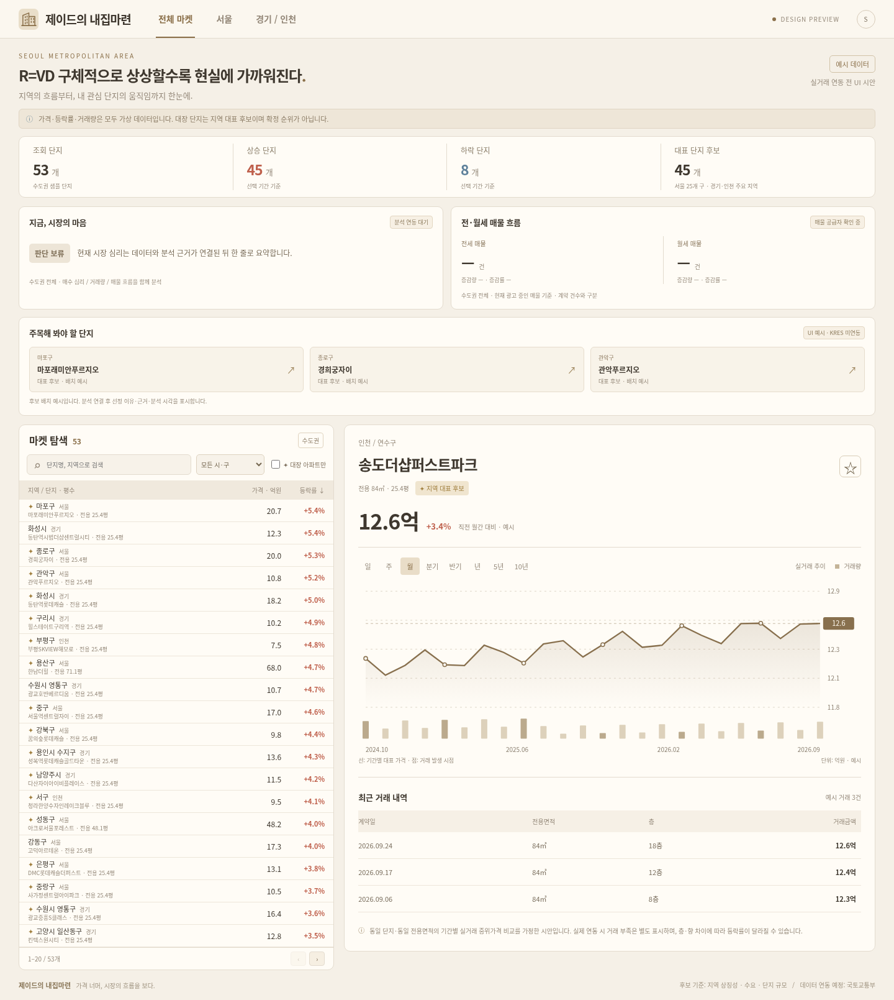

# 제이드의 내집마련 — 웹·모바일 인터랙티브 시안

실행: `cd jade-home-market && python3 -m http.server 4173 --bind 127.0.0.1`
외부 패키지 없이 index.html을 직접 열어도 동작합니다.

- 서울·경기·인천 전체 단지 기본, 지역/시구/검색/대장 후보 필터
- 일·주·월·분기·반기·연간·5년·10년, 단지 선택, 가격 차트, 정렬, 관심 단지 로컬 저장
- PC 좌우 분할, 모바일 목록 후 차트로 이동
- 모든 가격/등락률/거래/날짜/그래프는 가상 예시이며 실제 투자정보가 아닙니다.
- 대장 후보 45개: 서울 25개 구 + 경기 15개 주요 지역 + 인천 5개 구. 전체 지역 전수 선정은 아닙니다.
- 일반 단지 예시 8개 포함 총 53개 샘플. '전체'는 수도권 전체 조회 모드이며 실제 전체 단지 DB가 연결된 상태는 아닙니다.
- 후보는 지역 상징성·수요·규모를 고려한 초안. 실거래 분석에 의한 확정 순위가 아닙니다. data.js에서 수정할 수 있습니다.
- 광역 지역의 하위 생활권을 하나의 대표 단지로 모두 설명하지 않으며, 목동·여의도 등은 재건축 기대가 반영될 수 있습니다.
- 한남더힐/아크로서울포레스트는 각각 235/159㎡ 예시, 나머지는 84㎡ 예시. 단지 간 총액을 직접 비교하면 안 됩니다. 실제 연결 시 공식 면적·단지 식별자를 확인해야 합니다.
- kkaebigg.com은 프록시 403으로 열람하지 못했으며, 합의된 차트 중심 구성을 독립 제작했습니다.
- SVG 차트로 시안의 용량과 외부 의존성을 최소화했습니다. 프로덕션에서 실제 시계열과 확대/축소가 필요할 때 Lightweight Charts 연결을 검토합니다.

다음 단계: 후보 검토 → 국토부 단지/법정동 코드 매핑 → 실거래 API/취소거래 처리 → 동일 면적 중위가격/최소 거래수 규칙 → 관리자 화면.

## 시안 개편
베이지/브라운 테마, 건물 SVG 로고. 지역을 첫 줄에, 단지명/전용 환산 평수(㎡÷3.305785)를 둘째 줄에 표시. 전용 평수는 공급 평수가 아님. 행 높이 36px, 페이지당 20개 및 이전/다음 버튼. 5년/10년 추가. 가격·증감·장기 시계열 모두 예시. 브라우저 검증: 브랜드, 페이지 이동, 20행, 단지 차트 선택, 8개 기간, 모바일 가로 넘침 없음.

## 화면 미리보기

[모바일 시안](mobile.png) · [모바일 차트](mobile-chart.png)

저장소 루트에서 위 실행 명령을 실행합니다. 기존 텔레그램 봇과 독립된 정적 웹 시안으로, 토큰이나 추가 패키지가 필요하지 않습니다.
